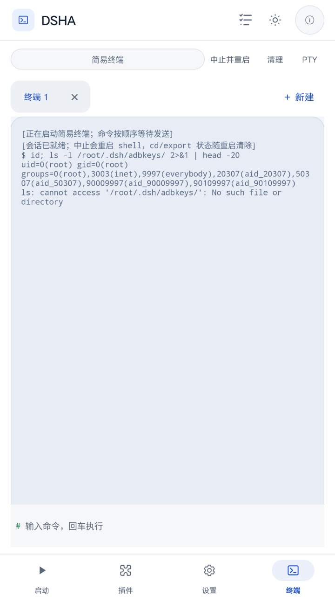
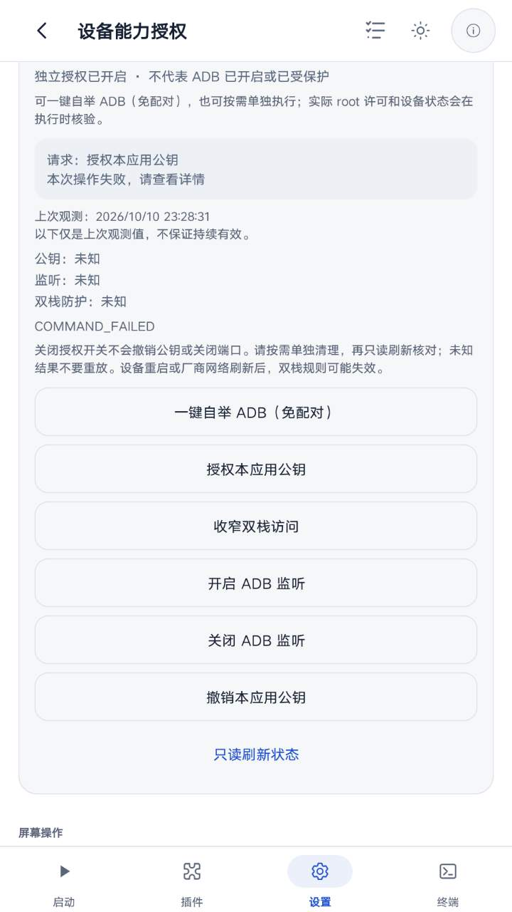

# Root 自举 ADB：虚拟屏真机验证（2026-10-10 / 交付包 `dsha-bootstrap-chain.apk`）

本轮在 **LENOVO TB321FU / Android 16（SDK 36）/ arm64-v8a** 上，用独立虚拟屏
（displayId 3，1008×1792）驱动**另一个包** `com.dsh.clienu.SunsetRNE` 验证 Root 自举
ADB 链的真实行为。该包与仓库工作树同源（见下「被测对象身份」），因此验证对象是
**当前源码编出的产物**，而不是本机正在运行的正式环境（`com.dsh.client`，版本码 165）。

> 结论摘要：**自举链代码按设计工作**（单飞、固定顺序、不重放、失败即停、设备零写入），
> 但在本机它**没有走完**，三处阻塞按顺序暴露：
> ① App 侧 ADB 环境准备未完成 → `ADB_ENVIRONMENT_NOT_READY`；
> ② 设备开着「无线调试」→ 原生侧按设计拒绝接管其它 ADB 入口（`REFUSED` /
> `OTHER_ADB_PORT_IN_USE`）；用户关闭无线调试后
> ③ 特权执行器第一步的双栈守卫探针 `/system/bin/iptables -w 2 -S INPUT` 返回非 0
> → `COMMAND_FAILED`，链停在任何写入之前。
> 由此得到 4 项待修：环境准备失败信息被丢弃（只剩错误码）、环境准备被塞进 120 秒
> 授权窗口、仓库自身会自动重开无线调试与自举规则冲突、双栈守卫探针在本机不可用。

## 1. 被测对象身份（逐字节核对）

| 项 | 值 |
|---|---|
| 已安装包 | `com.dsh.clienu.SunsetRNE`，versionCode 162，targetSdk 37，DEBUGGABLE |
| 安装时间 | firstInstall 2026-10-10 22:03:38 / lastUpdate 22:51:50（用户覆盖安装） |
| 设备上 `base.apk` | 292 661 080 字节 |
| `base.apk` SHA-256 | `f31d2bc4c945721d5a29f1b7455a119fbe59fba0accdedd843074b1794311778` |
| 交付件 `/sdcard/Download/dsha-bootstrap-chain.apk` | 同尺寸、同 SHA-256（`.sha256` 旁证一致） |
| root 授权 | KernelSU `ReSukiSU` allowlist 含 `com.dsh.clienu.SunsetRNE`；App 内显示「su：/system/bin/su · root 通道已响应」 |
| 签名 | AGP debug（与设备上原包同签名，可覆盖安装） |

包内含 `root_bootstrap_all`、`AdbBootstrapController`、`assets/adb-wheels.bin`
（9 951 074 字节，15 个 wheel，逐个 ZIP CRC 校验通过）。

## 2. 验证方法

- **虚拟屏**：`/app/vscreen/{status,launch,tree,see,tap,node,type,key,swipe}`，
  每次写入携带最新 `generation` + `frameSeq`（`STALE_*` 自动重试）。
  读取用 `/app/vscreen/tree`（无障碍树）与 `/app/vscreen/see`（预览帧）。
- **设备侧只读取证**：受保护的设备 shell（root，`/root/dsh-bin/adb-shell`）读
  `getprop`、`/data/misc/adb/adb_keys`、`/proc/net/tcp{,6}`、`ps -A`。
- **容器内省**：用**该包自己的「简易终端」**在其 Ubuntu 容器里执行只读命令
  （`ls`、`md5sum`、`command -v`），不依赖宿主。
- 本环境未安装任何 APK、未走 `pm install`（设备策略只允许 `pm` 查询）。

## 3. 基线（自举前，设备实测）

```
/data/misc/adb/adb_keys   : 1 行 —— unknown@localhost
service.adb.tcp.port      : 空
/proc/net/tcp             : 无 5555（0x15B3）监听
/proc/net/tcp6            : 无 5555；有 0x8EC3(=36547) 监听，uid 0 ← 系统无线调试
persist.adb.tls_server.enable = 1
service.adb.tls.port          = 36547
```

## 4. 结果

### 4.1 另一个包本身功能正常

虚拟屏内 `com.dsh.clienu.SunsetRNE` 启动正常：`运行环境 READY`、`DSH 未运行`、
底部导航（启动/插件/设置/终端）可用；「设置 → 设备能力授权」「自检与诊断」
「简易终端」均能打开并正常渲染。**没有出现**历史诊断记录里的整包资产为空、
`EOFException: End of input` 之类故障。

### 4.2 一键自举链被真实触发，但被前置条件挡住

在「设置 → 设备能力授权 → Root 自举 ADB」里点「一键自举 ADB（免配对）」→ 确认对话框
正文与设计一致（固定顺序 1 授权公钥 → 2 收窄双栈 → 3 开启 5555；任一步失败即停止、
不重试、不换通道）→ 点「确认自举」后卡片进入「正在执行，请等待结果」。

第一次执行结果（卡片原文）：

```
请求：授权本应用公钥
本次操作失败，请查看详情
ADB_ENVIRONMENT_NOT_READY
```

**设备状态零变化**：`adb_keys` 仍 1 行、`service.adb.tcp.port` 仍空、
`/proc/net/tcp{,6}` 仍无 5555；`ps -A` 全程没有该包的 proot/python 子进程。

### 4.3 容器内省：ADB 运行环境未就绪

在该包自己的终端里：

```
$ python3 -c 'import adb_shell_wifi; from spake2.spake2 import ...'
ModuleNotFoundError: No module named 'adb_shell_wifi'
$ ls /root/.dsh/wheels           → No such file or directory
$ tail /root/.dsh/adb-setup.log  → No such file or directory   （setup 从未执行）
$ ls -l /root/dsh-bin/           → adb-shell 包装器存在（184B，可执行）
$ md5sum /root/.dsh/{adb-shell.py,adb-pair.py,adb-setup.sh,device-shell-policy.py}
   与 APK 内同名资产逐字节一致；script-version=20
$ ls -l /usr/bin/python3.12 /usr/lib/aarch64-linux-gnu/lib{sqlite3.so.0,readline.so.8}
   全部存在
```

即：**脚本注入 ✔、glibc Python ✔、离线 wheel 缓存 ✘、setup 从未跑**。

对应 `AdbBridge.ensureReady()` 的判据序列，可以确定它**没有返回 `SETUP_DONE`**，
因而 `clientPublicKey()` 抛出 `ADB_ENVIRONMENT_NOT_READY`；但**具体是哪一支**
（`SETTINGS_PENDING` / `SCRIPTS_FAILED` / `GLIBC_PY_INSTALL_FAIL` /
`WHEELS_INJECT_FAIL` / `WHEELS_EXTRACT_FAIL` / `SETUP_FAILED`）**无法从 App 侧观测**——
这正是 §5 缺陷 1。以容器内事实推断，失败点在 `depsOk()==false` 之后的
wheel 注入/解包一段，或更早；`setup()` 确实从未执行（无 `adb-setup.log`）。

### 4.4 手工补齐同一份 wheel 后，链前进到原生安全门

把交付 APK 内的 `assets/adb-wheels.bin` 解出的 15 个 wheel 送进该包容器，执行它**自己的**
`/root/.dsh/adb-setup.sh`：

```
WHEELS_OK 15
KEY_GEN_OK
== [4/4] 安装 /root/dsh-bin/adb-shell 包装命令
SETUP_DONE
→ /root/.dsh/adbkeys/{adbkey,adbkey.pub}
```

再次点「一键自举 ADB（免配对）」→「确认自举」，本次结果（卡片原文）：

```
请求：授权本应用公钥
本次请求被拒绝
上次观测：2026/10/10 23:24:15
公钥：未知   监听：未知   双栈防护：未知
已有其他来源或端口的 ADB 监听，本次不会接管。请先在原调试入口核对。
```

代码对应 `RootBootstrapExecutor.verifyListenerScope()`：

```java
if (!disabled(getprop("service.adb.tls.port"))
    || getprop("persist.adb.tls_server.enable").equals("1"))
  throw new Refused("OTHER_ADB_PORT_IN_USE");
```

设备上这两个属性正是无线调试开启的标志。**这是设计行为**（`design.md`/`implementation-20261010.md`
第 3 条「其它 TCP 监听或无线 TLS 入口会拒绝授权/开启」），不是实现缺陷；但它意味着
**只要设备开着无线调试，root 免配对自举就不可用**，必须先关掉无线调试（`OPEN`
也会再次校验同一条件）。

### 4.5 关闭无线调试后：链前进到特权执行器，报 `COMMAND_FAILED`

用户随后确实关闭了无线调试，设备复读为

```
service.adb.tls.port            : 空
persist.adb.tls_server.enable   : 0
settings get global adb_wifi_enabled : 0
/proc/net/tcp6                  : 无 :8EC3 监听
```

在「一键自举」→「确认自举」之后，卡片给出**新的**结果（观测时间 23:28:31）：

```
请求：授权本应用公钥
本次操作失败，请查看详情
COMMAND_FAILED
```

`COMMAND_FAILED` 在全仓只有一个产生点：

```java
private String command(boolean mutation, String... args) throws Exception {
  return require(raw(Arrays.asList(args), mutation));      // ← 唯一产生点
}
private static String require(RootSupportProbe value) throws IOException {
  if (!value.succeeded())
    throw new IOException(value.exitCode < 0 ? "COMMAND_RESULT_UNKNOWN" : "COMMAND_FAILED");
```

而 `AUTHORIZE` 的第一批特权命令就是双栈守卫探针：

```java
public void verifyGuard() throws Exception {
  for (String tool : new String[] {"/system/bin/iptables", "/system/bin/ip6tables"})
    if (!AdbBootstrapEngine.firstRuleProtects(
            command(false, tool, "-w", "2", "-S", "INPUT"), tag))
      throw new IOException("DUAL_STACK_GUARD_UNVERIFIED");
}
```

由此可判定：**失败发生在这两个探针之一——命令执行了但退出码非 0**。
（若命令成功、只是首条规则不匹配，会得到 `DUAL_STACK_GUARD_UNVERIFIED`；
`getprop` 类读取在同一设备/上下文里正常——本轮就是用它读的属性。）

设备侧事实：`/system/bin/iptables` 存在（523 352 字节，`/system/bin/ip6tables` 是它的
符号链接），legacy 表也在（`/proc/net/ip_tables_names` = `nat mangle raw filter`，
`ip6_tables_names` = `mangle raw filter`），设备上**没有** `nft`。

**未能取得该命令的 stderr/退出码**：`iptables` 不在设备命令白名单内（执行被
`[POLICY_BLOCKED]` 拦截），而绕过设备策略是明令禁止的；本轮也没有第二次观测通道
（见 §5 缺陷 1）。因此「iptables 探针返回非 0」是**代码路径上的确定结论**，
「为什么返回非 0（`-w` 不受支持 / netd 客户端权限 / 后端差异）」**尚无直接证据**，
需要在 App 里把原始输出与退出码暴露出来才能定案。

### 4.6 用户交互过程（含一次「答复与设备事实不一致」）

为跑完 `NARROW` / `OPEN`，本轮通过 `/app/ask` 请求用户关闭无线调试。

1. 用户第一次选择「已关闭无线调试，继续验证」。**设备复读仍为开启**
   （`adb_wifi_enabled=1`、`persist.adb.tls_server.enable=1`、
   `service.adb.tls.port=36547`、`/proc/net/tcp6` 仍有 `:8EC3` LISTEN），
   因此当时**没有继续执行**——不以用户答复代替设备事实。
2. 用户第二次明确「已经关闭无线调试，继续」。这次设备复读确认关闭
   （见 §4.5 开头的四行证据），才继续运行。

需要注意的**产品冲突**：本仓库自身会**主动开启/重开无线调试** ——
`BootReceiver`（有 `WRITE_SECURE_SETTINGS` 时开机直接置 `adb_wifi_enabled=1`）与
`DeviceBridgeService` 的「4) 自动重开无线调试」（`tryReopenWirelessDebug()`）。
两者与自举的「不接管其它 ADB 入口」规则直接矛盾：只要 DSHA 的 ADB 通道保活还在跑，
用户手动关掉的无线调试可能被重新打开，root 免配对自举就会一直被拒。

### 4.7 收尾状态（本轮结束时的设备事实）

```
/data/misc/adb/adb_keys     : 1 行（与基线一致，未新增）
service.adb.tcp.port        : 空
persist.adb.tcp.port        : 空
/proc/net/tcp  , tcp6       : 无 5555
```

即整轮验证**没有对设备 ADB 状态产生任何写入**；临时放在 `/sdcard/Download/DSHA/adb-wheels`
的 wheel 副本与本轮启动的本地 HTTP 服务已清理。
只在该包自己的容器里留下了正常的 ADB 运行环境（`/root/.dsh/wheels`、
`/root/.dsh/adbkeys/{adbkey,adbkey.pub}`、`adb-setup.log`），属于该应用自身的预期状态。

### 4.8 安全行为与设计一致

整轮验证（三次触发）中：链失败即停、未重试、未换通道；未写入 `adb_keys`、未改
`service.adb.tcp.port`、未开启监听、未新增双栈规则；`STATUS`-类观测与
「上次观测时间戳」分离显示；每次动作都要在该卡片单独确认。
三次结果分别停在：`ADB_ENVIRONMENT_NOT_READY` → `OTHER_ADB_PORT_IN_USE`（拒绝）
→ `COMMAND_FAILED`，每一步都保留现场、不自动重放。

## 5. 代码逻辑判定

**正常的部分**（与文档口径一致，主机 90/15/16/27 项测试亦通过）：

- 门禁只要求 **Root 许可 + 独立自举授权**，ADB 通道状态不参与（解决了「要先有 ADB 才能自举 ADB」的循环）。
- 单飞、固定顺序 AUTHORIZE→NARROW→OPEN、失败即终止、不重放、不换通道。
- 结果记录与「上次观测」分离；未决/未知结果不自动重放。
- 原生安全门（外部 ADB 入口、持久端口、`ro.adb.secure`、双栈守卫为首条规则）先于任何写入。

**需要修的问题**：

1. **可诊断性（建议优先修）**：`AdbBootstrapController.clientPublicKey()` 只把
   `ensureReady` 的结果折算成 `ADB_ENVIRONMENT_NOT_READY`，失败正文（
   `SETTINGS_PENDING:` / `SCRIPTS_FAILED:` / `WHEELS_INJECT_FAIL:` / `WHEELS_EXTRACT_FAIL:` /
   `SETUP_FAILED:` 及尾部输出）被丢弃。于是用户在卡片和诊断页都看不到原因，
   我们只能靠容器内省反推。建议把该正文写进快照详情或 `RuntimeHostPorts.record`。
2. **首次使用的前置条件**：一键自举的第 1 步要在 **120 秒授权票据窗口**内完成
   ADB 环境准备（注入 wheel + 安装，文档称「最长等待 3 分钟」）。干净安装上这条链
   大概率走不完（本机就是这样失败的）。建议把环境准备提到确认之前（带进度），
   或让它不占用本次动作票据。
3. **产品语义需要交代**：目标是「免系统配对弹窗获得 ADB 通道」，但设备开着无线调试时
   会被设计性拒绝；而**本仓库自己会开机自动开启、探活时自动重开无线调试**
   （`BootReceiver`、`DeviceBridgeService.tryReopenWirelessDebug`）。两者叠加的效果是：
   用户越依赖 DSHA 的无线调试通道，越用不了 root 免配对自举。需要二者之一让步：
   要么自举前先由本应用临时关闭无线调试（并在结束后恢复），要么让自举在检测到
   「本应用自己开启的」无线调试时走收窄而非拒绝。当前文案只让用户
   「在原调试入口核对」，没有指出这一点。
4. **双栈守卫在本机不可用（本轮新发现，Android 16 实测）**：`AUTHORIZE` 的第一步
   `verifyGuard()` 依赖 `/system/bin/iptables -w 2 -S INPUT` 与 `ip6tables` 同名探针，
   本机上它返回非 0，于是 `COMMAND_FAILED`、整条链停在写任何东西之前。
   需要在设备上确认并至少二选一：
   （a）把原始 argv/退出码/stderr 暴露到卡片与诊断记录，先让问题可见；
   （b）让守卫探测适配设备后端（探测 `iptables` / `nft` 可用性与 `-w` 参数支持，
   不支持的参数不要写死；`/proc/net/ip_tables_names` 已证明 legacy 表存在，因此
   问题在**调用方式/上下文**而不是「没有表」）。
   若不做（a），这一类失败在设备上就只剩一个 8 字母的错误码。

## 6. 本轮未验证（不得据此声明通过）

- `AUTHORIZE` 未成功过，因此 `NARROW` / `OPEN` / `CLOSE` / `REVOKE` 的真实执行、
  双栈规则落点、`5555` 回环监听与会话核验（`ADB_SESSION_ROOT/SHELL`）**全部未验证**。
- 未能取得 `iptables`/`ip6tables` 探针的退出码与 stderr：设备命令白名单不放行
  `iptables` 执行，绕过策略被禁止；App 侧也没有第二观测通道（§5 缺陷 1）。
- 未验证 ADB 环境准备的失败分支（是 `injectWheels`、`extractWheelsJava` 还是更早），
  原因同上；只能确定 `ensureReady` 没到 `SETUP_DONE`、`setup()` 从未执行。
- Low 版（minSdk 23）、API 23–25 反射标签、真实 IPv4/IPv6 外网连通矩阵。
- 未生成、未签名、未安装任何发布 APK；未改设备 Root/公钥/端口/防火墙
  （三次运行结束后 `adb_keys` 仍 1 行、无 5555、端口属性为空）。

## 7. 复现入口

```bash
# 虚拟屏：状态 / 树 / 预览（每次写入带 generation + frameSeq）
curl -s -H @/root/.dsh/.bridge_headers "http://127.0.0.1:3090/app/vscreen/status"
curl -s -H @/root/.dsh/.bridge_headers "http://127.0.0.1:3090/app/vscreen/tree"
curl -s -H @/root/.dsh/.bridge_headers "http://127.0.0.1:3090/app/vscreen/see"

# 设备侧只读基线
adb-shell --su "cat /data/misc/adb/adb_keys"
adb-shell --su "getprop service.adb.tcp.port"
adb-shell --su "getprop persist.adb.tls_server.enable"
adb-shell --su "cat /proc/net/tcp"

# 被测包身份
adb-shell "pm dump com.dsh.clienu.SunsetRNE"
adb-shell --su "sha256sum /data/app/~~*/com.dsh.clienu.SunsetRNE-*/base.apk"
```

辅助脚本见 `verify-vscreen/`（未入库临时目录）：`vctl.py`（树/点击/输入/预览，
带 `STALE_*` 重试）、`vs.sh`、`vn.sh`、`vt.sh`。证据图见 §8。

## 8. 证据图（虚拟屏截帧，720×1280 预览）

另一包在虚拟屏中正常运行（环境 READY、UI 完整）：



关闭无线调试后第三次自举的结果：观测时间 23:28:31，失败码 `COMMAND_FAILED`
（即 §4.5 的双栈守卫探针），公钥/监听/双栈三项仍是「未知」，说明确实没写任何东西：



> 虚拟屏同步目录 `verify-vscreen/`（未入库的临时目录）保留了本轮的控制脚本：
> `vctl.py`（树/点击/输入/预览，带 `STALE_*` 重试）、`vs.sh`、`vn.sh`、`vt.sh`
> （用该包自带“简易终端”做容器内省），以及 `see.json`/`tree.json` 原始回应。
